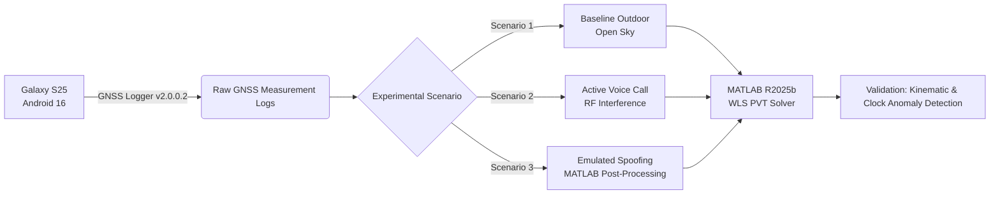
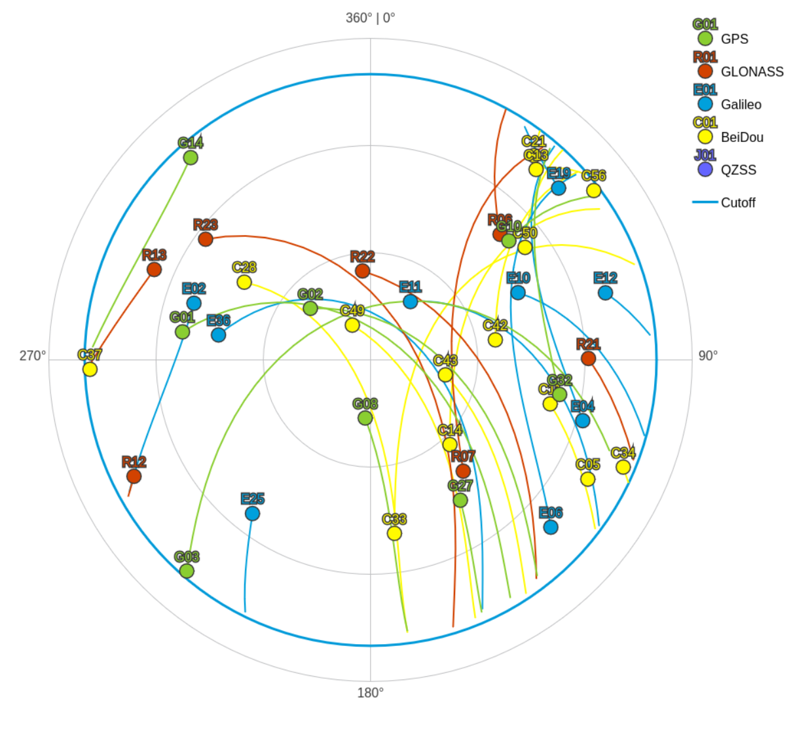
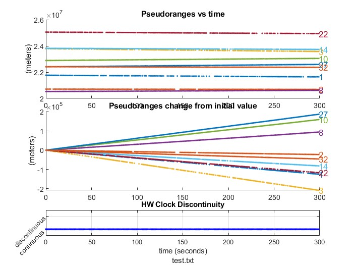
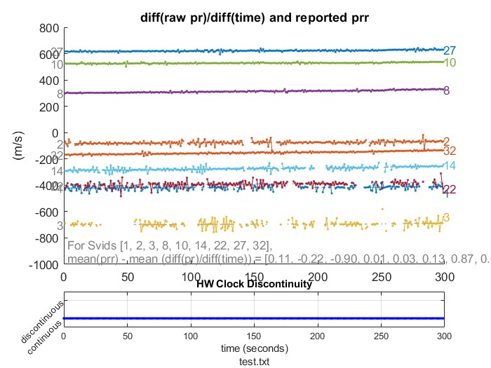
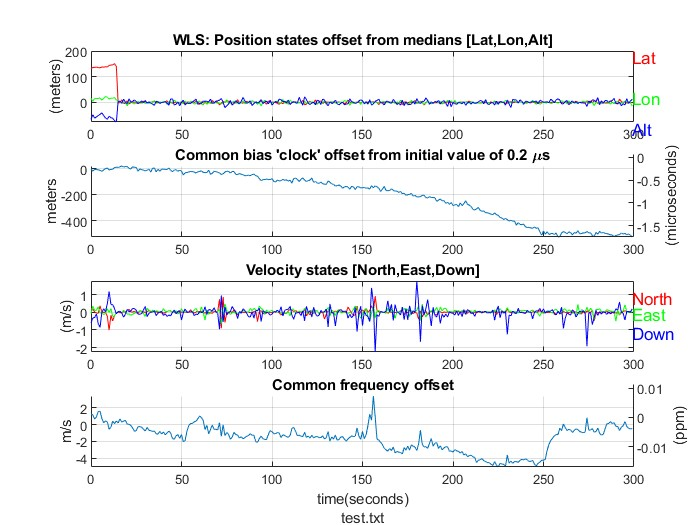

# Lab 01: GNSS Vulnerability, RF Interference & Spoofing Analysis

[](https://www.polito.it/)
[](https://www.polito.it/)
[](https://www.mathworks.com/)
[](https://www.android.com/)
[](report/WS_GNSS.pdf)

> **Full Technical Report**: [📄 Download / View `report/WS_GNSS.pdf`](report/WS_GNSS.pdf)

---

## 1. Overview & Research Objectives

Global Navigation Satellite Systems (GNSS) are fundamental to modern location and timing services, and smartphones rely heavily on them. Consumer receivers are nonetheless exposed to two distinct classes of threat, which stem from different weaknesses:

- **Spoofing**: open civil signals such as GPS L1 C/A have a publicly documented structure and carry no authentication of the ranging signal, so a receiver cannot tell a genuine satellite signal from a counterfeit one. An attacker can therefore broadcast fake signals that lead the receiver to compute false position or timing data.
- **RF interference / jamming**: GNSS signals reach the ground with extremely low power (well below the thermal noise floor), so even modest nearby RF emissions can degrade tracking. This weakness is physical and would not be solved by cryptography.

This laboratory investigates the GNSS measurement behaviour of a consumer-grade smartphone (Samsung Galaxy S25, Android 16) by:
1. **Capturing Raw GNSS Measurements**: Logging location fixes, raw GNSS measurements, navigation messages, GNSS status and sensor data with Google GNSS Logger v2.0.0.2 in an outdoor urban testbed at Politecnico di Torino.
2. **Computing PVT Solutions**: Solving the Position, Velocity, and Time (PVT) equations in MATLAB R2025b with a Weighted Least Squares (WLS) estimator, without inertial filtering.
3. **Evaluating Local RF Interference**: Assessing PVT degradation while the device is engaged in an active voice call.
4. **Emulating Spoofing Attacks**: Injecting counterfeit coordinates and an artificial time delay into the raw baseline measurements during post-processing, to characterize the receiver's response and the resulting detection signatures.

---

## 2. Experimental Setup & Testbed

| Parameter | Specification |
| :--- | :--- |
| **Target Device** | Samsung Galaxy S25 |
| **Operating System** | Android 16 |
| **Data Logging App** | Google GNSS Logger (v2.0.0.2) |
| **Processing Engine** | MATLAB R2025b + Google GPS Measurement Tools (v2.0.0.1, NavSAS spoofing variant) |
| **Location** | Politecnico di Torino, atrium outside the classroom next to the R3 building (approx. `45.066° N, 7.658° E`) |
| **Sessions** | Two 5-minute sessions: 18 March 2026 ~17:10 (baseline), 25 March 2026 ~16:20 (voice call) |
| **Signals Processed** | GPS L1 C/A (SVIDs 1, 2, 3, 8, 10, 14, 22, 27, 32 in the baseline pseudorange-rate analysis) |
| **Logger Settings** | GNSS Location, GNSS Measurements, Navigation Messages, GnssStatus, Sensors |



Since the two sessions were recorded 7 days apart at slightly different times, the satellite geometry of both acquisitions was compared through GNSS Planning skyplots (see Appendix A of the report). The constellation repeats every sidereal day (~23 h 56 min), so after 7 days it appears ~28 minutes earlier; the residual 12-minute offset from exact sidereal alignment explains the small shifts in satellite positions.

---

## 3. Experimental Scenarios & Methodology

### 3.1. Baseline Scenario
- **Setup**: 300 seconds of static acquisition, with one building in front of the receiver and open sky behind and on the sides (minimal signal obstruction).
- **Pseudorange Evolution**: Absolute code pseudoranges of about $2.30 \cdot 10^7 \text{ m}$, consistent with GPS L1 orbital geometry; variations over 300 s reach $\pm 2.0 \cdot 10^5 \text{ m}$, reflecting normal orbital motion (positive slope for satellites moving away, e.g. PRN 27; negative for satellites approaching, e.g. PRN 3).
- **Internal Consistency Check**: The empirical time derivative of the raw pseudoranges $\frac{\Delta \rho}{\Delta t}$ was compared with the pseudorange rate reported by the device. Radial velocities range from about $-800$ to $+600 \text{ m/s}$, and the mean differences between the two metrics fall between $-0.90$ and $+0.87 \text{ m/s}$, indicating good tracking stability.
- **Hardware Clock**: No hardware clock discontinuities occurred during the 300 s session, showing that Android battery-management mechanisms did not interrupt the GNSS clock.

### 3.2. Voice Call RF Interference
- **Methodology**: Same physical setup and configuration as the baseline, with the target smartphone engaged in an active voice call with another nearby device throughout the logging session.
- **Result**: Latitude, longitude, velocity, common frequency offset and clock bias behaved consistently with the baseline. The altitude component, however, showed severe instability, with spikes dropping down to about $-60 \text{ m}$, mostly in the latter part of the acquisition.

### 3.3. Emulated Coordinate Spoofing
- **Methodology**: The counterfeit coordinates of Piazza Castello, Turin (`45.076795° N, 7.683674° E`) were injected into the baseline measurements at $t = 50 \text{ s}$ by setting `spoof.active = 1` and `spoof.position` in the processing script.
- **Kinematic Signatures**: Because the WLS solver processes each epoch independently, without inertial filtering, the coordinate shift produced:
  - A sharp step function in the position states at $t = 50 \text{ s}$, after which the solution settles on the spoofed target.
  - A maximum horizontal velocity peak of $2.36 \text{ m/s}$ at $t = 72 \text{ s}$.
  - A vertical (Down) velocity anomaly dropping to nearly $-2 \text{ m/s}$.
  - A velocity standard deviation 38% higher than the baseline ($\sigma_{\text{spoofed}} = 0.226 \text{ m/s}$ vs. $\sigma_{\text{baseline}} = 0.163 \text{ m/s}$).

### 3.4. Emulated Clock Delay Spoofing
- **Methodology**: A time delay of $0.001 \text{ s}$ (`spoof.delay`) was applied uniformly across all tracked satellite channels, without altering the target coordinates.
- **Physical Impact**: The estimated 3D position did not change significantly. Since the delay lengthens all pseudoranges equally, the WLS estimator absorbed the whole error into the **receiver clock bias** state, which shows a sudden offset.
- **Detection**: The attack is invisible on a map but produces a large spike in $\frac{\Delta \rho}{\Delta t}$ and an abrupt step in the clock bias. Monitoring these quantities is a key defence for timing-critical infrastructure (e.g. 5G networks) that depends on GNSS time synchronization rather than positioning.

---

## 4. Key Results Summary

| Scenario | Position | Velocity | Clock Bias | Key Signature |
| :--- | :--- | :--- | :--- | :--- |
| **Baseline** | Stable, static solution | $\sigma = 0.163 \text{ m/s}$ | Continuous, no hardware discontinuities | Measured vs. reported pseudorange rate within $[-0.90, +0.87] \text{ m/s}$ |
| **Voice Call** | Lat/Lon nominal; altitude spikes down to $\approx -60 \text{ m}$ | Near zero, consistent with a static receiver | Close to baseline | Vertical channel degradation |
| **Position Spoofing** | Step at $t = 50 \text{ s}$, settles on Piazza Castello | Horizontal peak $2.36 \text{ m/s}$ at $t = 72 \text{ s}$; Down $\approx -2 \text{ m/s}$; $\sigma = 0.226 \text{ m/s}$ (+38%) | Not discussed in the report | Kinematic anomalies in the velocity states |
| **Delay Spoofing (1 ms)** | Essentially unchanged | Not discussed in the report | Sudden step offset | Spike in $\frac{\Delta \rho}{\Delta t}$ |

**Conclusions**: The baseline showed stable tracking, while local RF interference from the voice call significantly degraded the vertical position accuracy. The software-injected spoofing manipulated the position solution without altering standard metrics such as $C/N_0$ or HDOP; however, the unnatural absence of thermal noise in the spoofed pseudoranges is a clear mathematical anomaly that can be exploited for detection. Future work should explore physical spoofing with Software-Defined Radios (SDR) and detection algorithms based on these signal-variance anomalies.

---

## 5. Visual Evidence & Plots

| Sky Plot & Constellation Visibility | Emulated Position Spoofing Map |
| :---: | :---: |
|  |  |
| *Satellite geometry and expected trajectories* | *Sudden position deviation to the spoofed target* |

| Pseudorange Evolution | Velocity Anomaly Detection |
| :---: | :---: |
|  |  |
| *Tracked satellite pseudoranges over 300 s* | *Horizontal velocity comparison: baseline vs. spoofed* |

---

## 6. Directory Structure

```text
01_GNSS/
├── gps-measurement-tools_NavSAS_spoofing_students/   # MATLAB processing scripts & PVT algorithms
├── images/
│   ├── call_interference/                            # Plots recorded during active voice call
│   ├── delay_spoofing/                               # Plots from 1 ms clock delay injection
│   ├── originals/                                    # Nominal baseline plots
│   └── position_spoofing/                            # Plots from coordinate spoofing attack
├── references/                                       # Academic reference guides and course slides
└── report/
    └── WS_GNSS.pdf                                   # Complete ACM-format technical report
```

---

## 7. Authors

* **Emanuele Tocci** — Politecnico di Torino
* **Antonio Amendolara** — Politecnico di Torino
* **Alberto Mercurelli** — Politecnico di Torino
* **Davide Marin** — Politecnico di Torino
