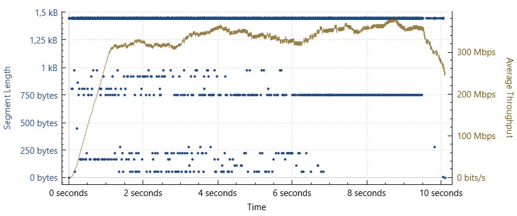
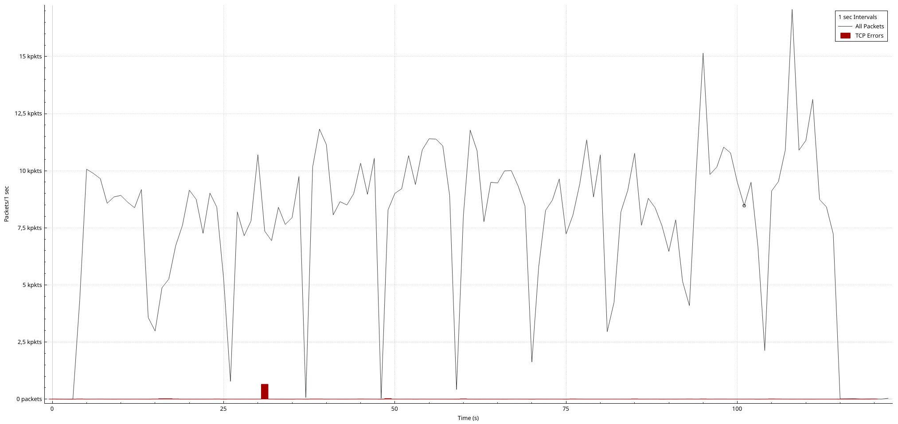

# Lab 02: Wi-Fi Performance & Network Bottleneck Analysis

[](https://www.polito.it/)
[](https://www.polito.it/)
[](https://www.wireshark.org/)
[](https://www.python.org/)
[](report/WS_Wifi_Performance.pdf)

> **Full Technical Report**: [📄 Download / View `report/WS_Wifi_Performance.pdf`](report/WS_Wifi_Performance.pdf)

---

## 1. Overview & Research Objectives

The achievable goodput in wireless networks often deviates substantially from nominal physical-layer bitrates due to medium contention, protocol encapsulation overheads, and transport-layer congestion control dynamics.

This laboratory presents a rigorous empirical and theoretical performance evaluation of TCP and UDP transport protocols across three distinct physical network topologies:

1. **Direct Ethernet Link**: Point-to-point wired baseline over an auto-negotiated 100 Mbps Fast Ethernet bottleneck.
2. **Purely Wireless Link**: Peer-to-peer Wi-Fi 6 (IEEE 802.11ax) communication mediated by a commercial Access Point (TIM Hub+), evaluating the half-duplex two-hop transmission penalty.
3. **Mixed Topology**: Heterogeneous link combining Gigabit Ethernet and Wi-Fi 6.

To guarantee reproducibility and statistical rigor, an automated Python orchestration suite was designed to execute 10-run measurement campaigns with automated metric aggregation (mean, minimum, maximum, and standard deviation). Packet-level dynamics were captured and dissected using Wireshark.

---

## 2. Theoretical Framework

The maximum achievable goodput $\hat{G}$ is bounded by the nominal link capacity $C$ and the protocol efficiency $\eta_{\text{protocol}}$:

$$\hat{G} < \eta_{\text{protocol}} \cdot C$$

Protocol efficiency accounts for layer overheads across standard Maximum Transmission Units (MTU = 1500 B):

- **TCP Efficiency**:
  $$\eta_{\text{TCP}} = \frac{\text{MSS}}{(\text{MSS} + H_{\text{TCP}} + H_{\text{IP}}) + H_{\text{ETH}}} = \frac{1460}{(1460 + 20 + 20) + 38} \approx 0.949$$
- **UDP Efficiency** (iperf default 1470 B payload):
  $$\eta_{\text{UDP}} = \frac{1470}{(1470 + 8 + 20) + 38} \approx 0.957$$

### Shared Medium Penalty in Half-Duplex Wi-Fi

In the purely wireless scenario, both stations share the same physical channel. Because the Access Point operates in half-duplex and cannot transmit and receive simultaneously, traffic must be relayed in two serial hops ($\text{STA}_1 \to \text{AP} \to \text{STA}_2$), halving available airtime by a factor of $0.5$:

$$\hat{G}_{\text{Wi-Fi}} < C \cdot \eta_{\text{protocol}} \cdot 0.5$$

---

## 3. Experimental Testbed

| Parameter | STA 1 (Server) | STA 2 (Client) | Access Point / Router |
| :--- | :--- | :--- | :--- |
| **Device Model** | MSI Prestige 15 A12UC | ASUS ROG Zephyrus G16 | TIM Hub+ |
| **Operating System** | Kubuntu (Linux 6.12.74) | CachyOS / Arch (Linux 6.18.22) | RouterOS |
| **Wireless NIC** | Intel Wi-Fi 6 AX211 (80 MHz) | Arrow Lake CNVi Wi-Fi (160 MHz) | 802.11ax (5.2 GHz) |
| **Nominal Wi-Fi PHY** | $1201.0 \text{ Mbps}$ | $2593.5 \text{ Mbps}$ (TX) / $1921.5 \text{ Mbps}$ (RX) | Dual-band Wi-Fi 6 |
| **Ethernet NIC** | TP-Link Megabit (100 Mbps bottleneck) | Tiergrade Gigabit (1000 Mbps) | 4x 1 Gbps RJ45 ports |


---

## 4. Key Results & Findings

### Summary of Experimental Goodput (TCP Flows)

| Topology | Test ID | Direction | Theoretical Bound ($\hat{G}$) | Measured Avg | Min | Max | Std Dev ($\sigma$) |
| :--- | :---: | :---: | :---: | :---: | :---: | :---: | :---: |
| **Both Ethernet** | **A** | Forward | $94.90 \text{ Mbps}$ | **$93.82 \text{ Mbps}$** | $93.70$ | $93.90$ | **$0.06$** |
| **Both Ethernet** | **B** | Reverse | $94.90 \text{ Mbps}$ | **$94.10 \text{ Mbps}$** | $94.10$ | $94.10$ | **$0.00$** |
| **Both Wi-Fi** | **C** | Forward | $450.38 \text{ Mbps}$ | **$413.80 \text{ Mbps}$** | $352.00$ | $465.00$ | **$39.40$** |
| **Both Wi-Fi** | **D** | Reverse | $450.38 \text{ Mbps}$ | **$248.26 \text{ Mbps}$** | $47.50$ | $407.00$ | **$118.81$** |
| **Mixed Mode** | **E** | Forward | $900.75 \text{ Mbps}$ | **$732.40 \text{ Mbps}$** | $640.00$ | $797.00$ | **$44.52$** |
| **Mixed Mode** | **F** | Reverse | $900.75 \text{ Mbps}$ | **$798.20 \text{ Mbps}$** | $685.00$ | $922.00$ | **$64.36$** |

### Key Observations

1. **Wired Stability**: The direct Ethernet link matches theoretical expectations within 98.8% efficiency, exhibiting near-zero variance ($\sigma = 0.06$).
2. **Wireless Half-Duplex Penalty**: Wireless goodput is strictly capped by the shared medium multiplier ($0.5$). While forward transmission achieved $413.80 \text{ Mbps}$ (91.8% of theoretical bound), reverse transmission exhibited higher variance ($\sigma = 118.81$) caused by transient channel contention and retransmissions.
3. **Mixed Topology Acceleration**: Bypassing the two-hop wireless hop nearly doubles network throughput, sustaining up to $798.20 \text{ Mbps}$ average goodput bounded by the Wi-Fi client interface capacity.

---

## 5. Visualizations & Packet Dissection

| Wi-Fi Scenario: TCP Goodput | Mixed Scenario: Client TCP I/O Graph |
| :---: | :---: |
|  |  |
| *Forward TCP goodput showing minor airtime fluctuations* | *Wireshark packet rate and throughput evolution* |

---

## 6. Automation Scripts Suite

All tests were orchestrated using the automated Python scripts located in [`scripts/`](scripts/):

- [`scripts/client.py`](scripts/client.py): Initiates 10 sequential measurement iterations against the server, parses standard throughput metrics using regular expressions, and outputs comprehensive statistical aggregates.
- [`scripts/server.py`](scripts/server.py): Lightweight server listener for TCP and UDP benchmarking.
- [`scripts/script.py`](scripts/script.py): Unified interactive entrypoint for client and server routines.

### How to Reproduce

1. **Start Server**:

   ```bash
   cd scripts
   python3 server.py
   # Select 'tcp' or 'udp'
   ```

2. **Start Client**:

   ```bash
   cd scripts
   python3 client.py
   # Provide Server IP, protocol (tcp/udp), and mode (standard/reverse)
   ```

---

## 7. Directory Structure

```text
02_Wifi/
├── measurements/
│   ├── ETH/                    # Raw logs and Wireshark plots for Ethernet scenario
│   ├── Mixed/                  # Raw logs and Wireshark plots for Mixed scenario
│   └── WiFi/                   # Raw logs and Wireshark plots for Wi-Fi scenario
├── references/                 # Standards, Wireshark filter cheat sheets, and guides
├── report/
│   └── WS_Wifi_Performance.pdf # Complete IEEE/ACM format technical report
└── scripts/                    # Automated Python benchmarking test suite
```

---

## 8. Authors

- **Emanuele Tocci** — Politecnico di Torino
- **Antonio Amendolara** — Politecnico di Torino
- **Alberto Mercurelli** — Politecnico di Torino
- **Davide Marin** — Politecnico di Torino
