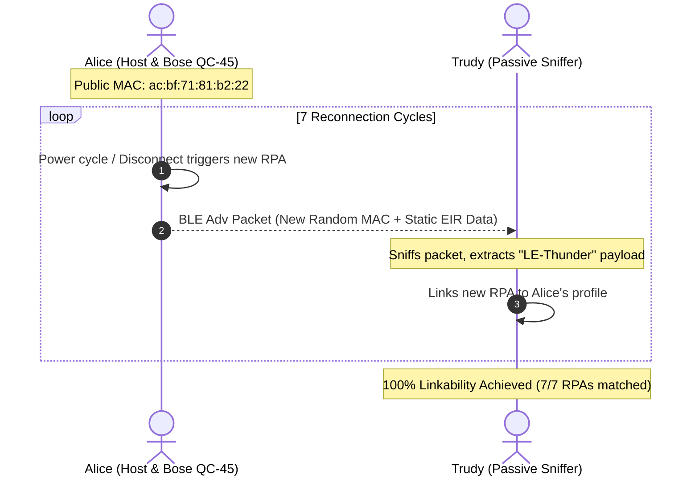
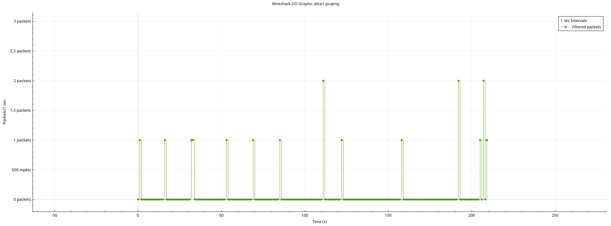
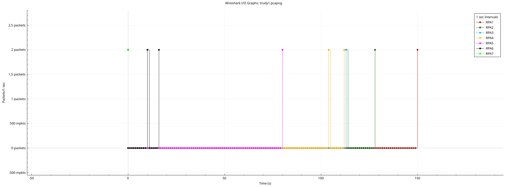

# Lab 03: BLE MAC Address Randomization & Linkability Analysis

[](https://www.polito.it/)
[](https://www.polito.it/)
[](https://www.bluetooth.com/)
[](https://www.wireshark.org/)
[](#)

---

## 1. Overview & Research Objectives

The Bluetooth Core Specification introduces **Resolvable Private Addresses (RPA)** to prevent passive eavesdroppers from tracking users across space and time. RPAs periodically randomize the link-layer MAC address by hashing an Identity Resolving Key (IRK).

However, while address randomization obfuscates device identity at Layer 2, upper-layer information elements broadcast in unencrypted advertising packets can compromise privacy. This laboratory demonstrates a practical **Linkability Attack** against a commercial Bluetooth Low Energy (BLE) peripheral:

1. **RPA Rotation Dynamics**: Inducing and observing genuine link-layer MAC rotations during consecutive pairing and advertising phases.
2. **Static Fingerprinting**: Exploiting unvarying payload fields, specifically the Complete Local Name (`LE-Thunder`) and Manufacturer Specific Data, within Extended Inquiry Response (EIR) packets.
3. **Passive Deanonymization**: Proving that a passive eavesdropper (Trudy) without cryptographic IRK material can link all 7 observed randomized addresses back to Alice's physical device.

---

## 2. Experimental Setup & Threat Model

The evaluation considers a classic security model consisting of Alice (legitimate user with target peripheral) and Trudy (passive RF observer).

| Entity | Role | Hardware / Software | Configuration / Notes |
| :--- | :--- | :--- | :--- |
| **Alice (Host)** | Target Master | PC running CachyOS (Linux kernel 7.0.8-1-cachyos-bore) | Manages BLE connection cycles |
| **Alice (Peripheral)** | Target Device | Bose QuietComfort 45 (QC-45) Headphones | **Public MAC**: `ac:bf:71:81:b2:22` |
| **Trudy (Sniffer)** | Passive Attacker | Laptop running ParrotOS 7.2 Live USB (Linux 6.19.13) | Promiscuous BLE packet sniffer |



---

## 3. Experimental Methodology & Attack Timeline

During the capture session, Alice manually initiated 7 sequential connection and disconnection cycles. Each reconnection forced the Bose QC-45 headset into an active advertising state, generating a fresh Resolvable Private Address (RPA).

### Captured Randomized Addresses (RPAs)

Trudy intercepted and successfully correlated all 7 distinct addresses generated during the experiment:

| Rotation # | Observed RPA Address | Extracted Fingerprint Name | Linkability Status |
| :---: | :---: | :---: | :---: |
| **#1** | `5f:5c:0f:06:8a:a3` | `LE-Thunder` | Successfully Linked |
| **#2** | `41:ad:22:28:d7:dd` | `LE-Thunder` | Successfully Linked |
| **#3** | `6b:6d:c1:09:07:89` | `LE-Thunder` | Successfully Linked |
| **#4** | `7f:fa:1c:29:08:09` | `LE-Thunder` | Successfully Linked |
| **#5** | `4c:3d:66:fb:b3:2d` | `LE-Thunder` | Successfully Linked |
| **#6** | `53:7c:ae:93:48:e2` | `LE-Thunder` | Successfully Linked |
| **#7** | `46:76:f6:33:0a:e2` | `LE-Thunder` | Successfully Linked |

**Static Device Public Address**: `ac:bf:71:81:b2:22`

---

## 4. Dissection & Wireshark Display Filters

To isolate and trace the target traffic within `.pcapng` packet captures, the following display filters were established:

### Sniffer (Trudy) Extraction Filters

* **Device Name Matching**:

  ```text
  btcommon.eir_ad.entry.device_name == "LE-Thunder"
  ```

* **Manufacturer Specific Data**:

  ```text
  btcommon.eir_ad.entry.data == 51:10:ac:83:6e:59:e5:46:0b:59:13
  ```

* **Combined Fingerprint Filter**:

  ```text
  (btcommon.eir_ad.entry.device_name == "LE-Thunder") || (btcommon.eir_ad.entry.data == 51:10:ac:83:6e:59:e5:46:0b:59:13)
  ```

* **Raw Payload Byte Matching**:

  ```text
  frame[29:12] == 0b:09:4c:45:2d:54:68:75:6e:64:65:72
  ```

### Host (Alice) Verification Filter

* **Monitoring RPA Advertisement Events**:

  ```text
  (bthci_evt.bd_addr == ac:bf:71:81:be:22) && (bthci_evt.le_meta_subevent == 0x0d) && (bthci_evt.le_peer_address_type != 0x01)
  ```

---

## 5. Visual Evidence & Capture Analysis

| Alice's Host View (Connection Events) | Trudy's Passive Sniffer View (Tracked RPAs) |
| :---: | :---: |
|  |  |
| *Bluetooth HCI event stream and connection cycles* | *Passive capture isolating all 7 rotated RPAs via payload filtering* |

---

## 6. Directory Structure

```text
03_Bluetooth/
├── plots/
│   ├── alice_plot.png    # Wireshark HCI event trace recorded by Alice
│   └── trudy_plot.png    # Wireshark packet capture trace recorded by Trudy
├── README.md             # Technical documentation & attack evaluation
└── setup.txt             # Original capture metadata, MAC addresses, and filters
```

---

## 7. Authors

* **Emanuele Tocci** — Politecnico di Torino 
* **Marco Ciucci** — Politecnico di Torino 
